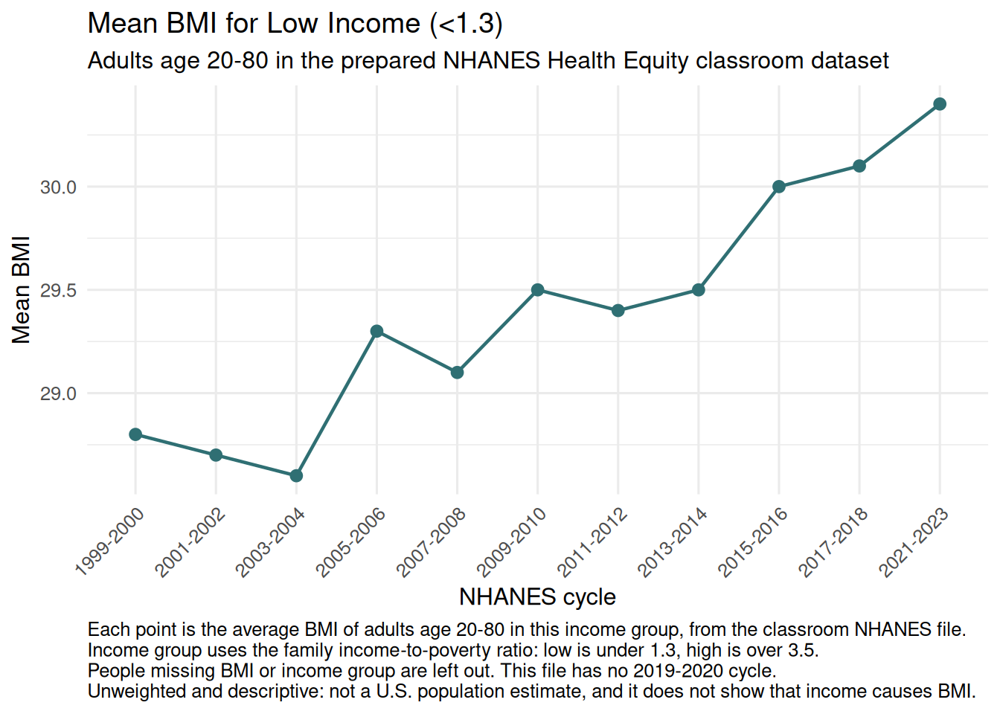

```{r}
#| label: setup
library(tidyverse)
library(knitr)

candidate_paths <- c(
  "examples/nhanes-equity/data/nhanes_equity_v6.csv",
  "../../../examples/nhanes-equity/data/nhanes_equity_v6.csv"
)
data_path <- candidate_paths[file.exists(candidate_paths)][1]
if (is.na(data_path)) {
  stop("Could not find examples/nhanes-equity/data/nhanes_equity_v6.csv")
}

nhanes <- read_csv(data_path, show_col_types = FALSE)

# Same cohort and summary as the Assignment 7 dashboard, for all three income groups.
group_summary <- nhanes |>
  filter(
    Age >= 20,
    Age <= 80,
    !is.na(IncomeGroup),
    !is.na(BMI),
    !is.na(Cycle)
  ) |>
  group_by(IncomeGroup, Cycle) |>
  summarise(n = n(), mean_bmi = round(mean(BMI), 1), .groups = "drop")

first_last <- group_summary |>
  group_by(IncomeGroup) |>
  arrange(Cycle, .by_group = TRUE) |>
  summarise(
    start = first(mean_bmi),
    end = last(mean_bmi),
    change = round(end - start, 1),
    min_n = min(n),
    .groups = "drop"
  ) |>
  mutate(IncomeGroup = factor(
    IncomeGroup,
    levels = c("Low Income (<1.3)", "Middle Income", "High Income (>3.5)")
  )) |>
  arrange(IncomeGroup)

low <- first_last |> filter(IncomeGroup == "Low Income (<1.3)")
```

## Why we are looking at this

**Who this is for:** members of the community health board, who are deciding whether to ask staff for a follow-up analysis of weight among lower-income adults.

**Question:** in a classroom copy of NHANES, has average BMI among lower-income adults age 20-80 gone up, gone down, or stayed about the same since 1999-2000?

**Why it matters:** if it has gone up, that is a reason to look more closely, using methods that can describe the whole population.

## What the data show

{fig-alt="Line chart of mean BMI for low-income adults age 20-80 across 11 NHANES cycles. The line starts at 28.8 in 1999-2000, dips to 28.6 in 2003-2004, and rises fairly steadily to 30.4 in 2021-2023." height="480"}

::: {style="font-size: 0.6em;"}
Figure from the Assignment 7 dashboard. The vertical axis starts near 28.5, not 0, so the slope looks steeper than a 1.6-point change. Source: classroom snapshot of CDC/NCHS NHANES public-use data [@cdc-nhanes].
:::

## The takeaway

In this dataset, **average BMI among lower-income adults went up by about `r low$change` points**, from `r low$start` in 1999-2000 to `r low$end` in 2021-2023. BMI compares weight to height. For someone 5 ft 7 in tall, `r low$change` BMI points is roughly 10 pounds.

The other two income groups went up by a similar amount, so this is not only a lower-income pattern:

```{r}
#| label: first-last-table
first_last |>
  select(IncomeGroup, start, end, change) |>
  kable(col.names = c("Income group", "1999-2000", "2021-2023", "Change"))
```

::: {style="font-size: 0.6em;"}
Average BMI of adults age 20-80 in each group. Every group has at least `r format(min(first_last$min_n), big.mark = ",")` adults in each survey cycle.
:::

## What this cannot tell us

- **Not a U.S. estimate.** These are plain averages of the people in the file. They ignore the NHANES survey weights, so they do not describe all U.S. adults.
- **Not a cause.** The chart shows a change over time. It does not show that income, or anything else, caused it.
- **Some people are left out.** Adults with no recorded BMI or income group are not counted, and the file has no 2019-2020 cycle.

## Suggested next step

Ask staff for a **weighted analysis that uses the NHANES survey design**, with uncertainty ranges, for all three income groups.

That would tell the board whether the rise holds for the U.S. adult population, and whether lower-income adults are actually pulling away from the other groups or just rising with them.

::: {style="font-size: 0.6em;"}
Data: classroom snapshot `nhanes_equity_v6`, prepared from CDC/NCHS NHANES public-use files [@cdc-nhanes]. Unweighted and descriptive. AI assistance (Claude Code) helped draft slide wording. All numbers were checked against the data.
:::

## References

::: {#refs}
:::
